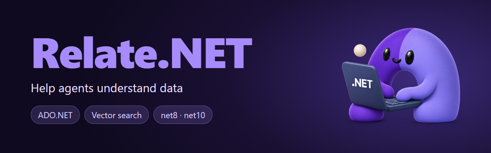

<p align="center">
  
</p>

.NET client for [Relate by Neo4j](https://relatedb.ai), the open-source embedded Cypher graph database built for AI agents. The engine runs **inside your process**: there's no server, container or credentials to manage. Open `:memory:` for a scratch graph or a single `.rl` file you can commit to a repo.

- **Driver-style API**: `RelateDatabase`, `RelateSession`, `RelateTransaction`, typed records, rich graph values (nodes, relationships, paths, temporals, points, durations, vectors).
- **ADO.NET provider**: `RelateDbConnection`, `RelateDbCommand`, `RelateDbDataReader` and a `DbProviderFactory`.
- **Bundled engine**: the native Relate library ships in the package for `win-x64`, `linux-x64`, `linux-arm64`, `osx-x64` and `osx-arm64`.
- **Built on Relate's typed C ABI v2** (the same one the official Go, Java, JS and Swift clients use), with `LibraryImport` source-generated interop. The package targets `net8.0` and `net10.0`, and is trimming- and AOT-annotated.

> Community package by [Ambystech](https://www.ambystech.io). Not affiliated with or endorsed by Neo4j, Inc. Relate is Apache-2.0 software by Neo4j.

## Install

```bash
dotnet add package Ambystech.Relate
```

| Package | Relate engine | C ABI |
| --- | --- | --- |
| 0.1.x | 1.0.2 | v2 |

## Quick start

```csharp
using Ambystech.Relate;

using var db = RelateDatabase.Open("./team.rl");   // or RelateDatabase.Open() for :memory:

db.Run("""
    CREATE (ada:Person {name: 'Ada'}), (grace:Person {name: 'Grace'}),
           (relate:Project {name: 'relate'}),
           (ada)-[:WORKS_ON {since: 2024}]->(relate),
           (grace)-[:WORKS_ON {since: 2023}]->(relate)
    """);

var result = db.Run(
    "MATCH (p:Person)-[w:WORKS_ON]->(:Project {name: $project}) RETURN p.name AS name, w.since AS since ORDER BY since",
    new { project = "relate" });

foreach (var row in result)
{
    Console.WriteLine($"{row["name"]} since {row.Get<int>("since")}");
}

Console.WriteLine(result.Summary.Counters.NodesCreated);   // 0: it was a read
Console.WriteLine(result.Summary.ElapsedMilliseconds);     // engine-reported timing
```

`RelateDatabase.Run` uses a shared default session. For concurrent work, open a session per unit of work:

```csharp
using var session = db.OpenSession();
var top = await session.RunAsync("MATCH (p:Person) RETURN p ORDER BY p.name LIMIT 10");
RelateNode first = top[0].Get<RelateNode>("p")!;
```

### Transactions

```csharp
using var session = db.OpenSession();

// Explicit
using (var tx = session.BeginTransaction())
{
    tx.Run("CREATE (:Item {n: $n})", new { n = 1 });
    string? bookmark = tx.Commit();          // "relate:<n>", or null when nothing was written
}                                             // disposing without Commit() rolls back

// Managed, retrying transient failures (e.g. write-write conflicts)
var created = session.ExecuteWrite(tx =>
    tx.Run("UNWIND range(1, $n) AS i CREATE (:Item {i: i})", new { n = 3 }).Summary.Counters.NodesCreated);
```

Compare bookmarks with `RelateBookmark.Sequence(bookmark)`, never as strings.

### Agent memory: vector search plus traversal

`SEARCH` and graph traversal run in the same Cypher statement:

```csharp
db.Run("""
    CREATE VECTOR INDEX fact_embedding IF NOT EXISTS
    FOR (f:Fact) ON (f.embedding) WITH [f.closed]
    OPTIONS {indexConfig: {`vector.dimensions`: 1536, `vector.similarity_function`: 'cosine'}}
    """);

var recall = db.Run("""
    MATCH (f:Fact)
    SEARCH f IN (VECTOR INDEX fact_embedding FOR $q WHERE f.closed = false LIMIT 5) SCORE AS score
    MATCH (f)-[:FROM]->(ep:Episode)
    OPTIONAL MATCH (f)-[:SUPERSEDES]->(prev:Fact)
    RETURN f.text AS fact, score, ep.text AS evidence, prev.text AS replaced
    """, new Dictionary<string, object?> { ["q"] = embedding /* float[] */ });
```

### Errors

Engine failures throw `RelateException` with the engine's classification: `Code` (Neo4j status code), `GqlStatus`, `Stage` (`Compile`, `Runtime`, `Internal`) and `Retryable`. Subclasses:

- `RelateClientException` for `Neo.ClientError.*`: fix the statement.
- `RelateTransientException`: retryable.
- `RelateDatabaseException` for `Neo.DatabaseError.*`.

## ADO.NET

```csharp
using Ambystech.Relate.Data;

using var conn = new RelateDbConnection("Data Source=./graph.rl");   // Mode=ReadOnly; Namespace=neo4j
conn.Open();

using var cmd = new RelateDbCommand("MATCH (p:Person) WHERE p.age >= $min RETURN p.name AS name", conn);
cmd.Parameters.AddWithValue("min", 30);          // "min", "$min" or "@min" all bind $min
using var reader = cmd.ExecuteReader();
while (reader.Read())
{
    Console.WriteLine(reader.GetString(0));
}
```

- Connections to the same store share one native database per process, because a store has a single writer. `:memory:` connections are private, as in SQLite.
- `ExecuteNonQuery` returns the graph changes (nodes and relationships created or deleted, plus properties set), or `-1`.
- Register the factory with `DbProviderFactories.RegisterFactory(RelateDbProviderFactory.InvariantName, RelateDbProviderFactory.Instance)`.
- **Dapper**: scalar parameters work (Dapper recognizes `$name`). Dapper expands `IEnumerable` parameters into `name1..nameN`, which Cypher's `$name` can't see, so pass lists and maps through `RelateDbCommand` or the driver API.

## More documentation

- [Type mapping](docs/type-mapping.md): Cypher to .NET, both directions.
- [Threading and store model](docs/threading-and-store-model.md): sessions, the single writer, sync engine.
- [Native library resolution](docs/native-library-resolution.md): `RELATE_LIB`, bundled natives, platform notes.

## Building from source

```bash
scripts/fetch-natives.sh 1.0.2      # stages the five natives into ./natives (from the official npm platform packages)
dotnet build -c Release
dotnet test -c Release
dotnet pack src/Ambystech.Relate.csproj -c Release -o artifacts
```

## License

Apache-2.0. The bundled Relate engine is Apache-2.0, © Neo4j, Inc.; see [THIRD-PARTY-NOTICES.md](THIRD-PARTY-NOTICES.md).
