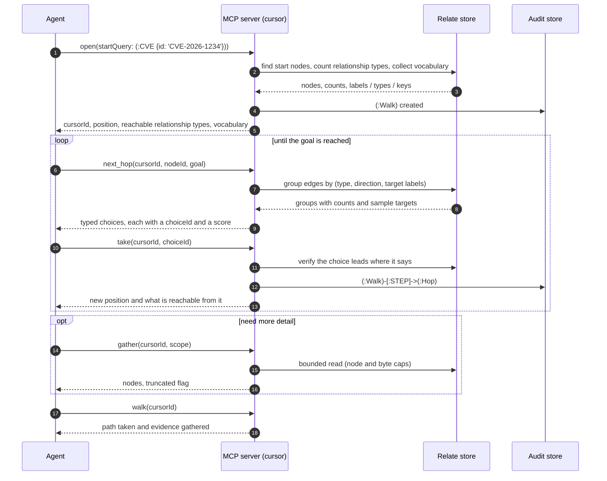

# Graph-Walking Agent Cursor

A demo MCP server for [Ambystech.Relate](../../README.md) built around one idea: **an agent should walk a graph one typed choice at a time instead of writing Cypher.**

The primary tool is `next_hop(node, goal)`, not `run_query(cypher)`. Every option the agent sees (relationship type, direction, target labels, sample targets) is read from the store, and `take` refuses anything the cursor did not offer. The agent therefore cannot hallucinate a label or relationship type, and the walk so far is its context. This is the "Graph-Walking Agent Cursor" idea from [jexp/relate-ideas](https://github.com/jexp/relate-ideas), implemented over the embedded Relate engine, so it runs in one process with no database server.

## Why `next_hop` instead of `run_query`

| | `run_query(cypher)` | `next_hop(node, goal)` + `take` |
| --- | --- | --- |
| What the agent writes | Cypher, from memory of a schema it may not have seen | A choice id copied from a response |
| Wrong label or relationship type | Silently returns nothing, or an error to recover from | Cannot be expressed: only offered options exist |
| Cost of a step | A query, plus guessing the schema first | One bounded response listing what is actually reachable |
| Context the agent keeps | Its own scratch reasoning | `walk`: the path and evidence so far, as compact JSON |
| Blast radius | Whatever the query can reach | Local reads with hard caps; no writes at all |
| Audit | Query logs | A graph of every hop, rebuilt with one query |

`run_query` still exists as an expert escape hatch, but it is **off by default** and is not even listed as a tool unless you start the server with `--allow-raw-query`.

## A walk



## Tools

| Tool | Purpose |
| --- | --- |
| `open(store?, startQuery?)` | Create a cursor on a start node set. Returns the nodes, the relationship types reachable in one hop (with counts) and the one-hop vocabulary (labels, relationship types, property keys). |
| `next_hop(cursorId, nodeId, goal)` | The typed choices from a node: `choiceId`, `relType`, `direction`, `targetLabels`, `count`, up to 3 sample targets, a `score` against the goal, and a `backtrack` flag. |
| `take(cursorId, choiceId \| targetNodeId)` | Move the cursor. A choice id moves to the choice's whole target set; a node id must have been returned by this cursor and be reachable through an offered choice. Anything else is rejected and the cursor does not move. |
| `gather(cursorId, scope)` | A bounded local read: `neighborhood2`, `properties` or `label:<L>` (only labels the cursor has already seen). Capped at 50 nodes and 4 KB by default. |
| `walk(cursorId)` | The path and the evidence so far. |
| `run_query(cypher)` | Read-only Cypher with a row cap and timeout. **Only with `--allow-raw-query`.** |

`startQuery` is restricted by default to a single node pattern, `(:Label {key: 'value'})`, which the server parses and rebuilds as a parameterized query. With `--allow-raw-query` it also accepts any read-only Cypher that returns nodes. Without a start query the cursor starts from the most connected nodes. `store` must be one of the names configured with `--store`: the agent never supplies a path.

Failures come back as MCP tool errors with a stable code at the start of the message: `not_offered`, `not_reachable`, `not_in_position`, `unknown_cursor`, `unknown_label`, `unknown_store`, `bad_scope`, `goal_required`, `start_query_rejected`, `empty_start`, `raw_query_disabled`, `not_read_only`, `invalid_cypher`, `query_failed`, `timeout`.

### How rejection works

The cursor remembers every node id it has ever returned (`Issued`) and the choices it offered from the current position (`Offered`).

- `take(choiceId)` works only if the id is in `Offered`. Choice ids are forgotten when the cursor moves.
- `take(nodeId)` works only if the id is in `Issued` **and** the store confirms an offered choice from the current position leads to it.
- `gather label:<L>` works only for labels the cursor has shown the agent.

Node ids are the engine's `elementId()` strings (for example `4:rl-id:n140`), copied from responses.

## Run it

You need the .NET 10 SDK and the staged native engine (see the [repo README](../../README.md#building-from-source)):

```bash
scripts/fetch-natives.sh 1.0.2
dotnet build samples/Ambystech.Relate.Samples.GraphCursor -c Release
dotnet run --project samples/Ambystech.Relate.Samples.GraphCursor -c Release --no-build -- --seed
```

The server speaks MCP over stdio. All logging goes to stderr, because stdout is reserved for the protocol.

| Flag | Meaning |
| --- | --- |
| `--seed` | Load the demo dataset (idempotent) into each store at startup. |
| `--store <name=path>` | A store the agent may open; repeatable. A bare path is named `default`. Default is a private `:memory:` store. Use a `.rl` path to persist. |
| `--audit <path>` | Write the audit graph to this `.rl` file instead of memory. |
| `--allow-raw-query` | Enable `run_query` and raw-Cypher start queries. |
| `--read-only` | Open the stores read-only (cannot be combined with `--seed`). |
| `--max-nodes <n>` | Nodes per call. Default 50. |
| `--max-text-bytes <n>` | Bytes of `gather` output. Default 4096. |
| `--max-choices <n>` | Choices per `next_hop`. Default 12. |
| `--row-cap <n>` | Rows from `run_query`. Default 100. |
| `--query-timeout-ms <n>` | `run_query` wall-clock limit. Default 5000. |

### Claude Code

```bash
claude mcp add graph-cursor -- dotnet run --project samples/Ambystech.Relate.Samples.GraphCursor -- --seed
```

`dotnet run` builds first when needed, and build output goes to stdout, which can corrupt the protocol on the first launch. Build once, then register the built assembly (or add `--no-build` to the command above):

```bash
dotnet build samples/Ambystech.Relate.Samples.GraphCursor -c Release
claude mcp add graph-cursor -- dotnet /absolute/path/to/samples/Ambystech.Relate.Samples.GraphCursor/bin/Release/net10.0/Ambystech.Relate.Samples.GraphCursor.dll --seed
```

### Claude Desktop

Add the server to `claude_desktop_config.json` (use absolute paths; on Windows, double the backslashes):

```json
{
  "mcpServers": {
    "graph-cursor": {
      "command": "dotnet",
      "args": [
        "/absolute/path/to/samples/Ambystech.Relate.Samples.GraphCursor/bin/Release/net10.0/Ambystech.Relate.Samples.GraphCursor.dll",
        "--seed",
        "--audit",
        "/absolute/path/to/graph-cursor-audit.rl"
      ]
    }
  }
}
```

## Example: from a CVE to the owning team

The demo dataset plants a chain for the goal *"find which team owns the service exposed to CVE-2026-1234"*:

```
(CVE-2026-1234) -[:AFFECTS]-> (log-parse) <-[:DEPENDS_ON]- (payments-gateway) -[:OWNED_BY]-> (Payments)
```

This transcript is a **real recording** of the server code answering the protocol calls below, abridged for length (sample lists and some counts are trimmed). The choices were made by a script that stands in for the agent, not by a live model. Note that the first hop is not the top-ranked one: the scorer only ranks, and the agent decides.

**1. `open(startQuery: "(:CVE {id: 'CVE-2026-1234'})")`**

```json
{"cursorId": "91f1c325cf094917b621e887e28af222", "store": "default",
 "position": [{"id": "4:rl-id:n140", "labels": ["CVE"], "props": {"id": "CVE-2026-1234", "severity": "critical", "published": "2026-03-02"}}],
 "outgoing": [{"relType": "AFFECTS", "direction": "out", "targetLabels": ["Dependency"], "count": 1}],
 "incoming": [{"relType": "CAUSED_BY", "direction": "in", "targetLabels": ["Incident"], "count": 1}],
 "vocabulary": {"labels": ["CVE", "Dependency", "Incident"], "relTypes": ["AFFECTS", "CAUSED_BY"], "propertyKeys": ["id", "name", "published", "severity", "summary", "title", "version"]}}
```

**2. `next_hop(cursorId, "4:rl-id:n140", goal)`**: the scorer ranks the incident first by lexical overlap, but the agent reasons that a vulnerable *dependency* leads to the exposed *service*.

```json
{"choices": [
  {"choiceId": "c1", "relType": "CAUSED_BY", "direction": "in",  "targetLabels": ["Incident"],   "count": 1, "score": 0.0786,
   "samples": [{"id": "4:rl-id:n198", "props": {"id": "INC-2026-0042", "title": "Remote code execution attempt against payments-gateway"}}]},
  {"choiceId": "c2", "relType": "AFFECTS",   "direction": "out", "targetLabels": ["Dependency"], "count": 1, "score": 0.05,
   "samples": [{"id": "4:rl-id:n137", "props": {"id": "dep-log-parse", "name": "log-parse", "version": "3.2.1"}}]}]}
```

**3. `take(cursorId, "c2")`** moves to `log-parse`. What is reachable from here: `AFFECTS` (in, from `CVE`) and `DEPENDS_ON` (in, from `Service`).

**4. `next_hop(cursorId, "4:rl-id:n137", goal)`**: the way back to the CVE is flagged `"backtrack": true` and ranked last, even though it scores higher because the goal mentions the CVE.

```json
{"choices": [
  {"choiceId": "c3", "relType": "DEPENDS_ON", "direction": "in", "targetLabels": ["Service"], "count": 1, "score": 0.35, "backtrack": false,
   "samples": [{"id": "4:rl-id:n138", "props": {"id": "svc-payments-gateway", "name": "payments-gateway", "tier": "tier-1"}}]},
  {"choiceId": "c4", "relType": "AFFECTS", "direction": "in", "targetLabels": ["CVE"], "count": 1, "score": 0.45, "backtrack": true}]}
```

**5. `take(cursorId, "c3")`** moves to `payments-gateway`, from which `OWNED_BY`, `DEPENDS_ON`, `CALLS`, `BUILT_FROM`, `INVOLVED` and `ON_CALL_FOR` are reachable.

**6. `next_hop(cursorId, "4:rl-id:n138", goal)`**: `OWNED_BY` matches both "owns" and "team" and ranks first.

```json
{"choices": [
  {"choiceId": "c5", "relType": "OWNED_BY", "direction": "out", "targetLabels": ["Team"], "count": 1, "score": 0.9167,
   "samples": [{"id": "4:rl-id:n0", "props": {"id": "team-payments", "name": "Payments", "area": "billing"}}]},
  {"choiceId": "c6", "relType": "CALLS", "direction": "out", "targetLabels": ["Service"], "count": 2, "score": 0.325},
  {"choiceId": "c7", "relType": "INVOLVED", "direction": "in", "targetLabels": ["Incident"], "count": 1, "score": 0.0786}]}
```

**7. `take(cursorId, "c5")`** moves to the `Payments` team. The goal is reached in three hops.

**8. A made-up move is refused:** `take(cursorId, "AFFECTS_EVERYTHING")`

```
not_offered: 'AFFECTS_EVERYTHING' was never returned by this cursor. Take a choiceId from next_hop or a node id it showed you.
```

The cursor stays on `Payments`.

**9. `walk(cursorId)`**

```json
{"goal": "find which team owns the service exposed to CVE-2026-1234", "start": ["4:rl-id:n140"],
 "steps": [
   {"seq": 1, "from": "4:rl-id:n140", "relType": "AFFECTS",    "direction": "out", "to": ["4:rl-id:n137"], "score": 0.05},
   {"seq": 2, "from": "4:rl-id:n137", "relType": "DEPENDS_ON", "direction": "in",  "to": ["4:rl-id:n138"], "score": 0.35},
   {"seq": 3, "from": "4:rl-id:n138", "relType": "OWNED_BY",   "direction": "out", "to": ["4:rl-id:n0"],   "score": 0.9167}],
 "position": [{"id": "4:rl-id:n0", "labels": ["Team"], "props": {"id": "team-payments", "name": "Payments"}}]}
```

## Scoring

Scoring is behind `IHopScorer`. The default `TokenOverlapScorer` is deterministic and needs no model: it measures token overlap between the goal and the relationship type (weight 0.5), the target labels (0.3) and the string values of the sample targets (0.2), plus a small bonus for low fan-out (at most 0.05). Words are lowercased, split on camelCase and punctuation, stripped of stop words and reduced by a deliberately crude suffix rule, so `owns` and `OWNED_BY` meet at `own`. Ties break by relationship type, direction and labels, so the order is stable.

It is lexical on purpose, and it will sometimes rank the wrong hop first (see step 2 above). It is the extension point for a calibrated decision-oracle scorer: implement `IHopScorer` and register it in `Program.cs`. That is not implemented here.

## Audit

Every `take` is logged to a separate store (in memory by default, or the `.rl` file from `--audit`) and never to the data store:

```
(:Walk {id, goal, startedAt})-[:STEP {seq, at, score}]->(:Hop {fromId, relType, toId})
```

When a choice moves the cursor to several targets, each target gets its own `STEP` and `Hop`, all sharing the step's `seq`. Rebuild a walk by its cursor id:

```cypher
MATCH (w:Walk {id: $id})-[s:STEP]->(h:Hop)
RETURN s.seq AS seq, h.fromId AS fromId, h.relType AS relType, h.toId AS toId, s.score AS score
ORDER BY seq, toId
```

For the walk above, this returns `1 n140 -[AFFECTS]-> n137`, `2 n137 -[DEPENDS_ON]-> n138`, `3 n138 -[OWNED_BY]-> n0`. Rejected moves are not logged.

## Demo dataset

`--seed` loads `Seed/org.cypher` (an embedded resource): a small "software org" graph of about 200 nodes, built with `MERGE` on stable ids so loading it twice changes nothing.

| Label | Count | Notes |
| --- | --- | --- |
| `Team` | 8 | |
| `Service` | 41 | 40 generated plus `payments-gateway` |
| `Repo` | 41 | one per service |
| `Dependency` | 30 | 29 ordinary plus `log-parse` |
| `CVE` | 23 | includes the planted `CVE-2026-1234` and two look-alike decoys, `CVE-2026-1243` and `CVE-2026-1324` |
| `Person` | 40 | five per team |
| `Incident` | 16 | |

Goals that fit it: the CVE-to-team chain above (3 hops), who is on call for that service (3 hops: `CVE -> Dependency <- Service <-[:ON_CALL_FOR]- Person`), or which incident the CVE caused (1 hop: `CVE <-[:CAUSED_BY]- Incident`).

The optional second dataset from jexp/relate-ideas is **not** included: the markdown-vault snapshot format is not supported by Ambystech.Relate.

## Limits

- **`run_query` cannot be cancelled.** The engine has no query timeout, so the timeout only stops the caller waiting; the statement may keep running. Results are materialized in full, so the row cap truncates after execution. To limit the risk, a query is first checked with `EXPLAIN` and refused unless it is a read, then executed in a transaction that is always rolled back.
- **Everything the server builds itself is bounded** with `LIMIT` and parameterized; the node and byte caps are applied in Cypher and again when serializing.
- **The backtrack flag is a heuristic:** a hop is flagged when it reverses the step just taken (same relationship type, opposite direction, back to the node it came from).
- **The scorer is lexical** and can be fooled by digits in ids and by repeated words in the goal.
- The cursor state lives in memory in the server process and is lost when it exits (the audit graph can persist).

## Tests

```bash
dotnet test samples/Ambystech.Relate.Samples.GraphCursor.Tests -c Release
```

They cover the protocol flow (open, next_hop, take, walk), rejection of invented and non-offered targets, the gather caps, scorer ordering and replacement, the audit graph (in memory and persisted to a file), seed idempotency, `run_query` being off by default and refusing writes, and a smoke test that launches the built server over stdio, checks the tool list and confirms that stdout carries only JSON-RPC.
